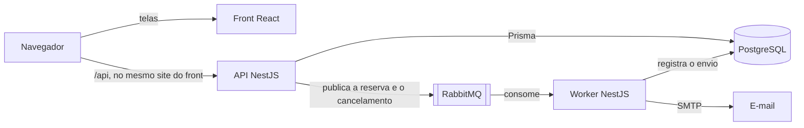

# agendei

Agendamento de serviços sem horário duplicado. O prestador cadastra os serviços e os horários de atendimento, e o cliente escolhe um horário livre e reserva. Quem impede duas reservas no mesmo horário é o próprio banco, com uma constraint de exclusão do PostgreSQL.

> Em desenvolvimento. O andamento segue o [plano de ação](docs/03-plano-de-acao.md).

**No ar em <https://agendei-green.vercel.app>.** Dá para entrar com as [contas de demonstração](#contas-de-demonstração).


## Como funciona



- A API responde a reserva sem esperar o e-mail: ela grava, publica a mensagem na fila e devolve. O worker, que é o mesmo código com outro ponto de entrada, manda o e-mail depois.
- O front chama a API pelo próprio endereço, em `/api`, para o cookie de sessão continuar `SameSite=Strict` ([ADR 0006](docs/adr/0006-front-chama-a-api-pelo-mesmo-site.md)).
- Duas reservas no mesmo horário esbarram numa constraint de exclusão do PostgreSQL, mesmo quando chegam juntas ([ADR 0002](docs/adr/0002-conflito-de-horario-no-banco.md)).

Os detalhes estão na [arquitetura](docs/02-arquitetura.md).

### Onde roda

- O front fica na Vercel. A API, o worker, o PostgreSQL e o RabbitMQ ficam no Railway.
- A cada push na `main`, a Vercel e o Railway publicam a versão nova. Antes de subir a API, o Railway aplica as migrações e refaz as contas de demonstração, então elas voltam ao estado inicial a cada deploy.
- Os e-mails do site no ar caem num Mailpit protegido por senha, e não numa caixa de verdade. Assim, quem testa pode usar endereços inventados.

## Stack

- API em NestJS 12 e TypeScript em modo strict
- PostgreSQL com Prisma
- Swagger com a documentação da API
- Login com senha em bcrypt, token de acesso de 15 minutos e renovação por cookie `httpOnly`, com rotação a cada uso
- Guardas por papel, limite de requisições no login e no cadastro, helmet e CORS só para o front
- Datas gravadas em UTC e interpretadas no fuso do prestador, com `@date-fns/tz`
- Vitest e Supertest nos testes, com cobertura mínima nas regras de horário, oxlint e Prettier no código
- E-mail de confirmação e de cancelamento por fila no RabbitMQ: a API publica e responde na hora, e um worker no mesmo código envia com o Nodemailer, uma vez só por reserva e tipo ([ADR 0003](docs/adr/0003-notificacoes-por-fila-rabbitmq.md))
- Front em React com Vite, React Router, TanStack Query, React Hook Form, Zod e Tailwind, chamando a API pelo próprio endereço, em `/api`

## Como rodar

Pré-requisitos: Node.js 22 e Docker.

```bash
docker compose up -d   # PostgreSQL, RabbitMQ e Mailpit
cd api
cp .env.example .env   # preencha o JWT_SECRET; o comando para gerar está no arquivo
npm install            # também gera o client do Prisma
npm run db:migrate     # cria as tabelas
npm run db:seed        # cria as contas de demonstração (opcional)
npm run start:dev
```

A API sobe em <http://localhost:3000>. A documentação fica em <http://localhost:3000/docs>.

O worker, que manda os e-mails, roda em outro terminal:

```bash
cd api
npm run start:worker
```

Sem o worker, a reserva funciona do mesmo jeito: as mensagens esperam na fila e os e-mails saem quando ele subir.

Com a API rodando, em outro terminal:

```bash
cd web
npm install
npm run dev
```

O front sobe em <http://localhost:5173>. O servidor do Vite repassa `/api` para a API, e assim o cookie de sessão funciona ([ADR 0006](docs/adr/0006-front-chama-a-api-pelo-mesmo-site.md)).

| Serviço local      | Endereço                                                   |
| ------------------ | ---------------------------------------------------------- |
| Painel do RabbitMQ | <http://localhost:15672> (usuário e senha `agendei`)       |
| Caixa do Mailpit   | <http://localhost:8025>, onde chegam os e-mails do agendei |

### Contas de demonstração

O `npm run db:seed` cria duas contas com dados fictícios, as duas com a senha `agendei-demo`:

| Conta     | E-mail              | O que já tem                                                                                    |
| --------- | ------------------- | ----------------------------------------------------------------------------------------------- |
| Prestador | `ana@example.com`   | três serviços e horários de segunda a sábado                                                    |
| Cliente   | `carla@example.com` | uma reserva no último dia útil e quatro nos dois próximos, uma delas cancelada, todas com a Ana |

Rodar de novo volta as duas contas ao estado inicial, com as reservas em volta do dia de hoje. Isso também apaga as reservas que outras contas fizeram com a Ana. O resto do banco fica como está.

## Scripts da API

Rodam dentro da pasta `api/`.

| Comando                     | O que faz                                                                                           |
| --------------------------- | --------------------------------------------------------------------------------------------------- |
| `npm run start:dev`         | sobe a API e reinicia a cada alteração                                                              |
| `npm run build`             | gera o build em `dist/`                                                                             |
| `npm run start:prod`        | sobe o build                                                                                        |
| `npm run start:worker`      | gera o build e sobe o worker dos e-mails                                                            |
| `npm run start:worker:prod` | sobe o worker a partir do build                                                                     |
| `npm run lint`              | roda o oxlint                                                                                       |
| `npm run typecheck`         | confere os tipos com o TypeScript                                                                   |
| `npm run format`            | formata o código com o Prettier                                                                     |
| `npm test`                  | roda os testes unitários                                                                            |
| `npm run test:e2e`          | roda os testes de integração, com o Docker Compose no ar (apaga o banco local e a caixa do Mailpit) |
| `npm run db:migrate`        | aplica e cria migrações do Prisma                                                                   |
| `npm run db:studio`         | abre o Prisma Studio                                                                                |
| `npm run db:seed`           | gera o build e cria ou refaz as contas de demonstração                                              |
| `npm run db:seed:prod`      | cria ou refaz as contas de demonstração a partir do build                                           |
| `npm run measure`           | mede o tempo de resposta da API que estiver rodando (veja [Desempenho](#desempenho))                |

## Desempenho

O requisito é responder em menos de 300 ms no p95, com o banco local, nas duas rotas mais usadas (RNF01). Com a API a partir do build (`npm run start:prod`) e o worker rodando, o `npm run measure` cria um prestador e um cliente, faz uma chamada de cada vez e mede do envio ao fim da resposta:

| Rota                       | Chamadas | Mediana | p95     | Máximo  |
| -------------------------- | -------- | ------- | ------- | ------- |
| `GET /providers/:id/slots` | 300      | 7,8 ms  | 10,4 ms | 15,3 ms |
| `POST /bookings`           | 100      | 17,7 ms | 27,4 ms | 43,6 ms |

Medido em 21/11/2026, num notebook com Intel Core i7-13620H, 32 GB de RAM e Windows 11, com o Node.js 22 e o PostgreSQL 17 e o RabbitMQ 4 no Docker Compose. A reserva inclui a gravação com a constraint de exclusão e a publicação na fila. Ela é medida a uma chamada a cada 2,1 s, porque a rota aceita 30 reservas por minuto de cada IP.

## Scripts do front

Rodam dentro da pasta `web/`.

| Comando             | O que faz                                       |
| ------------------- | ----------------------------------------------- |
| `npm run dev`       | sobe o front e atualiza a tela a cada alteração |
| `npm run build`     | gera o build em `dist/`                         |
| `npm run lint`      | roda o oxlint, com as regras de acessibilidade  |
| `npm run typecheck` | confere os tipos com o TypeScript               |
| `npm run format`    | formata o código com o Prettier                 |
| `npm test`          | roda os testes das telas e do cliente da API    |

## Documentação

- [Levantamento de requisitos](docs/01-requisitos.md)
- [Arquitetura](docs/02-arquitetura.md)
- [Plano de ação](docs/03-plano-de-acao.md)
- [Decisões técnicas (ADRs)](docs/adr/)
- [Revisões de ciclo](docs/ciclos.md)

## Licença

[MIT](LICENSE)
