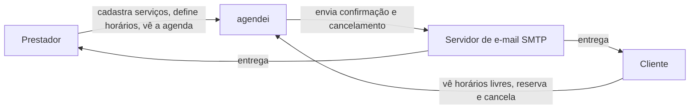
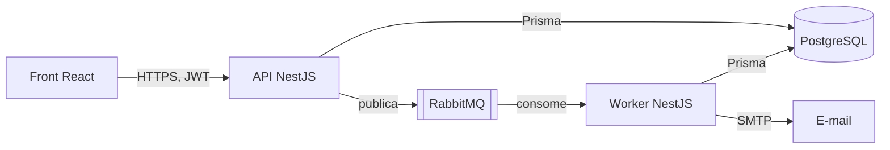
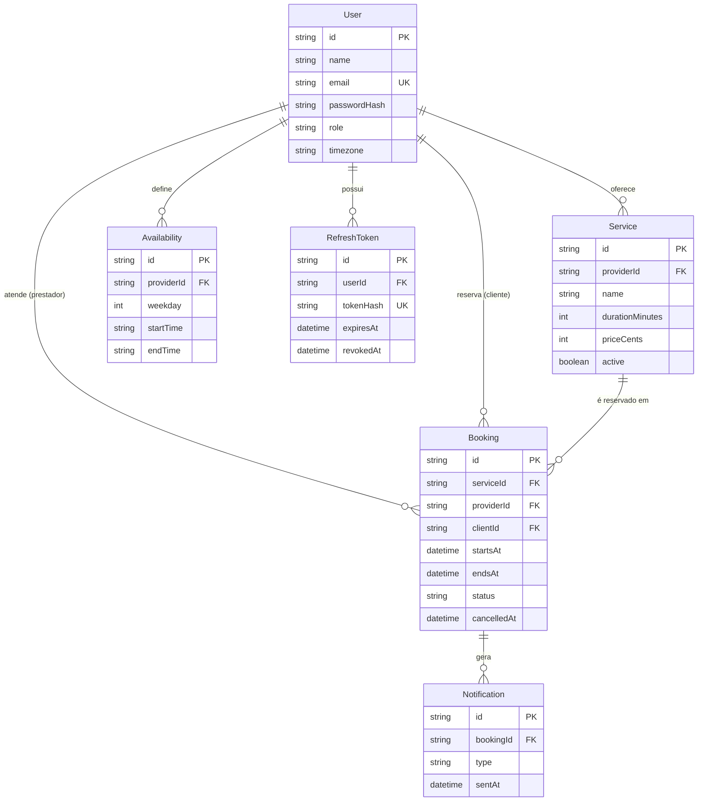
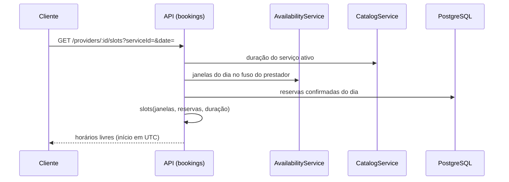
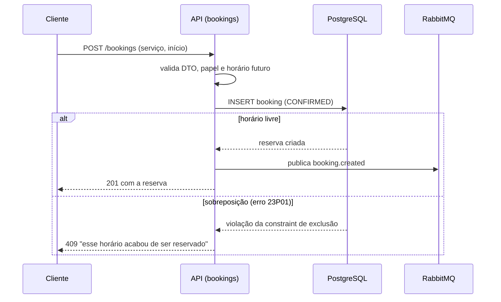
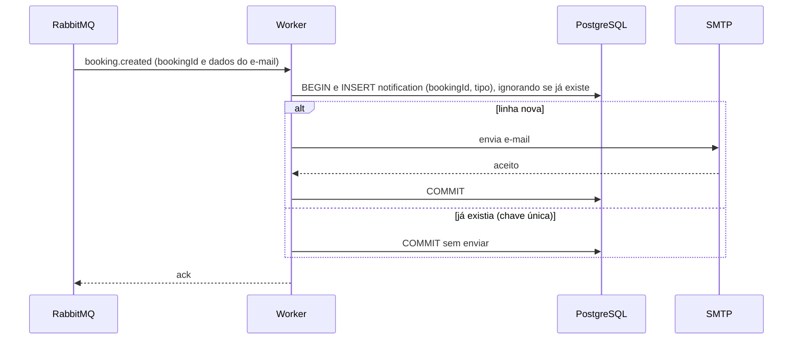

# Arquitetura: agendei

## 1. Estilo arquitetural

**Monolito modular em NestJS**: uma única base de código da API, dividida em módulos por área do domínio (auth, users, catalog, availability, bookings e notifications). O mesmo código sobe de duas formas: a API (`main.ts`) e um worker (`worker.ts`), que consome a fila do RabbitMQ. O front em React (Vite) é um app separado, uma SPA (aplicação de página única que fala com a API por HTTP).

Por que monolito modular:
- O domínio tem áreas claras, e o NestJS já organiza o código por módulo.
- Uma pessoa desenvolve: um repositório, um banco, uma API.
- A reserva precisa gravar no banco com a garantia de não sobrepor horário. Com um único banco, isso é uma operação só, sem transação distribuída.
- O worker reaproveita o mesmo código e o mesmo schema, só muda o ponto de entrada.

Regra de dependência entre módulos: um módulo só usa outro pelo service que ele exporta, e nenhum módulo acessa a tabela de outro diretamente pelo Prisma. Isso deixa as fronteiras claras e permite extrair um módulo no futuro sem reescrever os outros.

Alternativas avaliadas (detalhe no [ADR 0001](adr/0001-monolito-modular-nestjs.md)):

| Alternativa | Por que não agora |
|---|---|
| Microsserviços | é uma pessoa só, e a reserva viraria uma transação distribuída entre serviços |
| Monolito em camadas, sem módulos | o domínio tem áreas claras e o NestJS já organiza por módulo; sem fronteiras, o acoplamento cresce |
| Next.js full-stack | a API precisa ser independente do front e documentada com Swagger, para atender outros clientes no futuro, como um app mobile |

## 2. Contexto

Quem usa o sistema e com quais serviços externos ele conversa.



## 3. Containers

| Container | Tecnologia | Responsabilidade |
|---|---|---|
| Front (SPA) | React, Vite, React Router, TanStack Query, Tailwind, na Vercel | telas do cliente e do prestador |
| API | NestJS (`main.ts`), no Railway | rotas REST, autenticação, regras de negócio, publicação na fila, Swagger |
| Worker | NestJS (`worker.ts`), no Railway | consome a fila, envia o e-mail e registra o envio |
| Banco | PostgreSQL, no Railway | usuários, serviços, disponibilidade, reservas, tokens e envios |
| Fila | RabbitMQ, no Railway | mensagens `booking.created` e `booking.cancelled` |
| E-mail | Nodemailer; Mailpit em desenvolvimento | envio das mensagens por SMTP |



## 4. Organização do código

Seis módulos no `api/`, mais um módulo de infraestrutura (`prisma/`) que só fornece o cliente do banco.

| Módulo | Responsabilidade | Tabelas que são dele | Service que exporta |
|---|---|---|---|
| `auth` | cadastro, login, renovação e logout, guardas por papel | `RefreshToken` | `AuthService` (e os guards) |
| `users` | dados do usuário e do prestador (inclusive o fuso) | `User` | `UsersService` |
| `catalog` | serviços do prestador | `Service` | `CatalogService` |
| `availability` | janelas de atendimento da semana | `Availability` | `AvailabilityService` |
| `bookings` | horários livres, reserva, cancelamento e agenda | `Booking` | `BookingsService` |
| `notifications` | publicar na fila, consumir no worker, registrar envio | `Notification` | `NotificationsService` |

Regras de dependência:

- Um módulo só chama outro pelo service que ele exporta. Importar o `PrismaService` é permitido, mas só para as tabelas do próprio módulo.
- `bookings` é o módulo que mais depende dos outros: usa `AvailabilityService` (janelas do dia), `CatalogService` (duração do serviço), `UsersService` (fuso e nomes) e `NotificationsService` (publicar o evento).
- `notifications` não depende de `bookings`. A mensagem já carrega os dados do e-mail (nome, serviço, data e hora), então o worker não consulta outras tabelas.
- `auth` usa `UsersService` e não conhece o resto do domínio.
- A regra de horários livres fica em `bookings/slots.ts`, uma função pura, sem banco e sem NestJS, testada de forma isolada.

```
agendei/
├── api/
│   ├── prisma/
│   │   ├── schema.prisma
│   │   └── migrations/            # inclui o SQL escrito à mão da constraint de exclusão
│   ├── src/
│   │   ├── auth/
│   │   ├── users/
│   │   ├── catalog/               # serviços do prestador
│   │   ├── availability/
│   │   ├── bookings/
│   │   │   ├── bookings.controller.ts
│   │   │   ├── bookings.service.ts
│   │   │   └── slots.ts           # função pura dos horários livres
│   │   ├── notifications/         # publica na fila e consome no worker
│   │   ├── prisma/
│   │   ├── main.ts                # sobe a API
│   │   └── worker.ts              # sobe o worker
│   ├── test/
│   └── .env.example
├── web/
│   └── src/
│       ├── pages/
│       ├── components/
│       ├── api/
│       └── hooks/
└── docker-compose.yml             # PostgreSQL, RabbitMQ e Mailpit
```

## 5. Modelo de dados



- `role` é `PROVIDER` ou `CLIENT`; `status` da reserva é `CONFIRMED` ou `CANCELLED`; `type` do envio é `CONFIRMATION` ou `CANCELLATION`.
- `Notification` tem chave única em (`bookingId`, `type`): é ela que impede o e-mail em dobro (RN12).
- `Booking` tem a constraint de exclusão `booking_no_overlap`, que não existe no schema do Prisma e entra numa migração SQL escrita à mão (o Prisma permite). Ela compara `providerId` e o intervalo `tstzrange(startsAt, endsAt)` só entre reservas `CONFIRMED` ([ADR 0002](adr/0002-conflito-de-horario-no-banco.md)).
- Preço em centavos (inteiro), para não haver erro de arredondamento (RN02).
- `startsAt` e `endsAt` são `timestamptz`, gravados em UTC. `Availability.startTime` e `endTime` são horas locais do prestador (`HH:mm`) e `User.timezone` diz qual é o fuso ([ADR 0005](adr/0005-datas-em-utc-com-fuso-do-prestador.md)).
- `RefreshToken` guarda só o hash do token, nunca o valor.
- Índices: `Booking(providerId, startsAt)` para a agenda e os horários livres, e `Booking(clientId, startsAt)` para "minhas reservas".

## 6. Fluxos principais

### 6.1 Consultar horários livres



`slots` é uma função pura: recebe janelas, reservas e duração e devolve os horários de início possíveis, de 30 em 30 minutos. Não consulta banco nem relógio, então os casos (horário passado, almoço, serviço maior que a janela, dia sem atendimento) são testados sem mock.

### 6.2 Reservar sem conflito



A API não consulta "está livre?" antes de gravar como garantia: a garantia é o próprio INSERT. A checagem em `slots` serve para mostrar opções ao cliente. Se a fila estiver fora do ar, a reserva já foi gravada: o erro de publicação vai para o log e a resposta continua `201`.

### 6.3 Confirmação por fila



O cancelamento segue o mesmo caminho, com a mensagem `booking.cancelled` e o tipo `CANCELLATION`. Se o envio falhar, a transação é desfeita, e a linha de `Notification` some junto. O worker tenta de novo, até 3 vezes, com 2 s e 10 s de espera, e depois da terceira falha registra o erro no log e confirma a mensagem. Duas entregas da mesma mensagem ao mesmo tempo também não duplicam: a segunda espera a primeira na chave única e não insere nada ([ADR 0003](adr/0003-notificacoes-por-fila-rabbitmq.md)).

## 7. Decisões técnicas

| Decisão | Escolha | Registro |
|---|---|---|
| Estilo arquitetural | monolito modular em NestJS, com API e worker no mesmo código | [ADR 0001](adr/0001-monolito-modular-nestjs.md) |
| Conflito de horário | constraint de exclusão no PostgreSQL (`tstzrange` e `btree_gist`) | [ADR 0002](adr/0002-conflito-de-horario-no-banco.md) |
| E-mail de confirmação | fila RabbitMQ e tabela de envio com chave única | [ADR 0003](adr/0003-notificacoes-por-fila-rabbitmq.md) |
| Sessão | JWT de 15 minutos em memória e refresh em cookie, com rotação e hash no banco | [ADR 0004](adr/0004-jwt-curto-e-refresh-em-cookie.md) |
| Datas | UTC no banco e fuso do prestador para interpretar dia e janelas | [ADR 0005](adr/0005-datas-em-utc-com-fuso-do-prestador.md) |
| Front e API | o front chama a API no próprio domínio, em `/api`, pelo proxy do Vite e pelo rewrite da Vercel | [ADR 0006](adr/0006-front-chama-a-api-pelo-mesmo-site.md) |

Escolhas sem ADR, por serem padrão de mercado: Prisma (ORM mais usado com TypeScript, com migrações), `class-validator` nos DTOs (objetos que descrevem o corpo de cada requisição), Swagger (documentação da API gerada do código), Nodemailer e Mailpit (e-mail), React Hook Form e Zod (formulários), TanStack Query (cache de dados da API no front), date-fns (datas), Vitest e Supertest (testes), oxlint (lint) e Prettier (formatação). Vitest e oxlint são o padrão do template do NestJS 12.

## 8. Segurança

| Camada | Medida |
|---|---|
| Entrada | `class-validator` em todos os DTOs, recusando campos desconhecidos; Zod nos formulários do front só para ajudar o usuário |
| Senha | bcrypt |
| Sessão | JWT de acesso de 15 minutos, só em memória no front; renovação por cookie `httpOnly`, `Secure` e `SameSite`, com rotação a cada uso e só o hash no banco |
| Autorização | guardas do NestJS por papel (cliente não acessa rota de prestador e vice-versa); toda rota confere o dono do recurso, e o de outro usuário devolve 404 |
| Abuso | `@nestjs/throttler` no login e no cadastro |
| Rede | helmet (cabeçalhos de segurança) e CORS liberado só para o front |
| Banco | consultas só pelo Prisma; a constraint de exclusão garante a regra mesmo que o código falhe |
| Dados pessoais | o e-mail traz só nome, serviço, data e hora; logs sem senha, token ou e-mail completo |
| Erros | mensagem genérica para o usuário; detalhe só no log |
| Segredos | só em variáveis de ambiente; `.env.example` sem valores reais |
| Dependências | Dependabot e `npm audit` no CI |

## 9. Ambientes e deploy

| Ambiente | Onde | Serviços |
|---|---|---|
| Desenvolvimento | máquina local | Docker Compose com PostgreSQL, RabbitMQ e Mailpit; a API e o worker rodam com npm, e o front com o servidor do Vite |
| Produção | Railway, na região us-west2 (API, worker, PostgreSQL 17, RabbitMQ e Mailpit), e Vercel (front, com rewrite de `/api` para a API) | os e-mails caem num Mailpit protegido por senha, porque o agendei no ar é uma demonstração e não manda e-mail para fora |

Como o deploy funciona:

- A Vercel publica o front a cada push na `main`, a partir da pasta `web/`. O `web/vercel.json` repassa `/api/*` para a API no Railway e manda o resto para o `index.html`, para as rotas do React Router abrirem direto.
- O Railway refaz a API e o worker a cada push na `main` que mexe em `api/`. Antes de subir a API, ele aplica as migrações (`prisma migrate deploy`) e refaz as contas de demonstração (`node dist/seed.js`). A API só entra no ar quando o `GET /health` responde.
- O limite de requisições conta o IP de cada cliente pelos dois caminhos que chegam à API:
  - Chamada direta ao Railway: o proxy do Railway troca o `X-Forwarded-For` pelo IP que conectou nele, e a API lê esse IP com `TRUST_PROXY=1`. Um `X-Forwarded-For` inventado não muda nada.
  - Chamada pela Vercel: o IP que chega ao Railway é o de saída da Vercel, que muda a cada chamada. O IP do cliente vem no `x-vercel-forwarded-for`, e a API só confia nele quando o cabeçalho `x-origin-secret` traz o segredo de `ORIGIN_SECRET`. A Vercel grava esse cabeçalho em toda chamada repassada e troca o valor que o visitante mandar.
- Os segredos (JWT, banco, RabbitMQ, `ORIGIN_SECRET` e a senha do Mailpit) ficam só nas variáveis do Railway e da Vercel.

Esteira do CI (GitHub Actions), a cada push: lint → checagem de tipos → testes unitários → testes de integração e de concorrência (Postgres como serviço do Actions) → build.

## 10. Observabilidade

- Logs estruturados da API e do worker, com o id da requisição e sem dados pessoais.
- O worker registra cada mensagem processada, ignorada por duplicidade ou com erro.
- Rota `GET /health` para o Railway verificar se a API está de pé.
- Página de erro amigável no front; o detalhe fica só no log.
- Medição do tempo das rotas `slots` e `POST /bookings` antes de cada versão, com o resultado no README.
